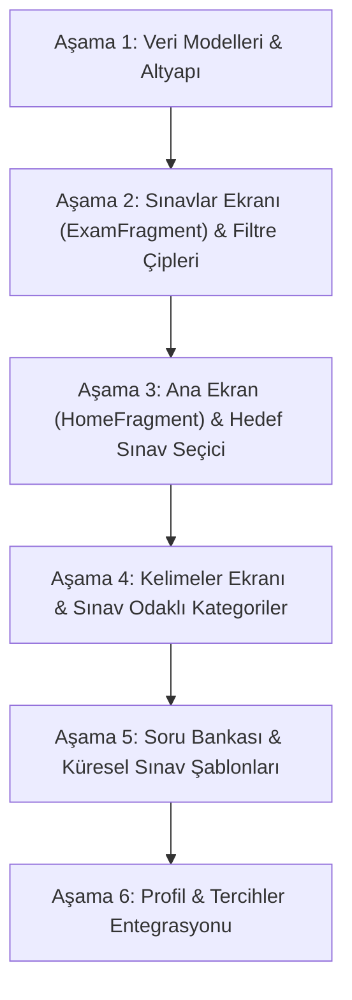

# Global Exam Expansion Master Plan
## Global YDS -> Global English Exam Hub (TOEIC, IELTS, TOEFL, Cambridge, SAT, PTE, DET, GRE, YDS)

**Proje:** Global YDS (VocabMaster)  
**Tarih:** 30 Ekim 2026  
**Hedef Kitle:** Küresel İngilizce Seviye & Yeterlilik Sınavı Adayları (Yıllık 30+ Milyon Katılımcı)  
**Durum:** Planlandı / Uygulamaya Hazır  

---

## 1. Pazar Analizi & Hedef Sınav Matrisi (Çin Hariç Küresel Sıralama)

| Sınav | Yıllık Katılımcı | Ana Coğrafya | Sınav Odağı & Soru Karakteristiği |
| :--- | :--- | :--- | :--- |
| **1. TOEIC (L&R)** | **~7 Milyon** | Japonya, G. Kore, Tayvan, Fransa | İş İngilizcesi, kurumsal yazışma, dilbilgisi, okuma parçaları (YDS'ye format olarak en yakın küresel test) |
| **2. Cambridge English** | **~5.5 - 6 Milyon** | Avrupa, Latin Amerika, Asya | B2 First, C1 Advanced, C2 Proficiency. Gramer ve bağlamsal kelime kullanımı (Use of English) |
| **3. IELTS (Acad./Gen.)** | **~3.5 - 4 Milyon** | Hindistan, Birleşik Krallık, Avustralya, Kanada, Orta Doğu | Üniversite ve göçmenlik. Akademik okuma, sinonimler, akademik kelime dağarcığı |
| **4. EIKEN** | **~3.5 - 4 Milyon** | Japonya | Japonya lise/üniversite ve kurumsal terfiler. Çoktan seçmeli okuma ve kelime |
| **5. TOEFL iBT** | **~2.5 - 3 Milyon** | ABD, Kanada, Latin Amerika, Global | İleri düzey akademik metinler, üniversite ders notları, kavramsal çıkarımlar |
| **6. SAT / ACT** | **~2 Milyon** | ABD, Asya, Uluslararası Okullar | Reading & Writing. İleri seviye eleştirel okuma ve analiz |
| **7. PTE Academic** | **~1.5 - 2 Milyon** | Hindistan, Avustralya, Birleşik Krallık | Yapay zekâ değerlendirmeli hızlı online sınav |
| **8. Duolingo Test (DET)** | **~1.5 - 2 Milyon** | Global Online | Pratik bilgisayar uyarlamalı kelime ve tamamlama testi |
| **9. GRE / GMAT (Verbal)** | **~500.000** | ABD, Avrupa, Küresel | Yüksek lisans/MBA. Dünyanın en zorlu elit kelime ve mantık soruları |
| **10. YDS / YÖKDİL** | **~400.000** | Türkiye | Memuriyet, TUS/DUS ve akademik kariyer odaklı okuma/dilbilgisi |

---

## 2. Mimari ve Veri Modeli Değişiklikleri

### A. Sınav Türü Tanımı (`ExamType`)
```kotlin
enum class ExamType(
    val code: String,
    val displayName: String,
    val flag: String,
    val description: String,
    val defaultDurationMinutes: Int
) {
    ALL("ALL", "Tüm Sınavlar", "🌍", "Tüm genel ve akademik sınavlar", 15),
    TOEIC("TOEIC", "TOEIC", "🇯🇵", "Business & Daily Workplace English", 20),
    IELTS("IELTS", "IELTS", "🇬🇧", "Academic & General Training", 20),
    TOEFL("TOEFL", "TOEFL iBT", "🇺🇸", "University & Academic English", 18),
    CAMBRIDGE("CAMBRIDGE", "Cambridge (B2/C1)", "🇪🇺", "First & Advanced English", 15),
    SAT("SAT", "SAT / ACT", "🎓", "Reading, Writing & Logic", 15),
    PTE("PTE", "PTE Academic", "⚡", "Fast AI-Scored University Test", 12),
    DET("DET", "Duolingo Test", "🦉", "Adaptive Online University Test", 10),
    GRE("GRE", "GRE / GMAT", "🏛️", "Advanced Verbal & Vocabulary", 15),
    EIKEN("EIKEN", "EIKEN", "🌸", "Japan Standard English Test", 15),
    YDS("YDS", "YDS / YÖKDİL", "🇹🇷", "Türkiye Akademik & Memuriyet", 15)
}
```

### B. `Exam` Modelinin Genişletilmesi
```kotlin
data class Exam(
    val id: String = "",
    val title: String = "",
    val totalQuestions: Int = 0,
    val durationMinutes: Int = 0,
    val examType: String = "ALL",        // TOEIC, IELTS, TOEFL vb.
    val levelBadge: String = "B2-C1",    // A2, B1, B2, C1, C2
    val difficulty: String = "Medium"    // Easy, Medium, Hard, Expert
)
```

### C. `Word` Modelinin Genişletilmesi
* Kelimelere `targetExams` etiketleri (örn: `["IELTS", "TOEFL", "GRE"]`) eklenerek kullanıcıların sadece ilgilendikleri sınavın kelime havuzunu filtreleyebilmesi sağlanır.

### D. Kullanıcı Tercihleri (`AppPreferences`)
* `KEY_TARGET_EXAM`: Kullanıcının ana hedef sınavı (Varsayılan: `ALL` veya cihaz diline göre Türkiye için `YDS`, Asya için `TOEIC`, Global için `IELTS`).

---

## 3. Ekran Güncellemeleri ve Yeni Arayüz Bileşenleri

### 1. Ana Ekran (`HomeFragment`)
* **Üst Bölüm - Hedef Sınav Seçici (Exam Carousel):**
  * Kullanıcının hazırlandığı sınavı seçebileceği yatay kaydırmalı, modern kartlar.
  * Kart üzerinde: Bayrak emojisi, Sınav adı, Katılımcı hacmi etiketi (örn: "7M Aday"), format özeti.
* **Kişiselleştirilmiş Günün Modülü:**
  * Kullanıcı TOEIC seçtiyse -> "Günün TOEIC İş İngilizcesi Kelimesi" ve "TOEIC Okuma Egzersizi".
  * Kullanıcı IELTS seçtiyse -> "Akademik Kelime Kartı" ve "IELTS Reading Parçası".
* **Hızlı Aksiyon Butonları:** Sınav başlat, Kelime kartlarını çevir, Gramer test et.

### 2. Sınavlar Ekranı (`ExamFragment`)
* **Yatay Kaydırılabilir Filtre Çipleri (`ChipGroup`):**
  * `[🌍 Tümü] [🇯🇵 TOEIC] [🇬🇧 IELTS] [🇺🇸 TOEFL] [🇪🇺 Cambridge] [🎓 SAT] [⚡ PTE] [🦉 DET] [🏛️ GRE] [🇹🇷 YDS]`
* **Zenginleştirilmiş Sınav Kartları:**
  * Renkli sınav etiketi (Badge): `IELTS Academic • 20 dk • 10 Soru • C1`.
  * Çözülme durumu ve en yüksek skor göstergesi.
* **Arama & Filtre:** Sınav başlığına veya sınav türüne göre anlık arama.

### 3. Kelimeler Ekranı (`VocabularyFragment`)
* Sınav paketleri filtresi:
  * *IELTS High-Band Vocabulary (8.0+)*
  * *TOEIC Workplace & Business Essentials*
  * *TOEFL Academic Keyword List*
  * *GRE Verbal Elite 500*
  * *YDS / YÖKDİL En Çok Çıkan Kelimeler*
* Kelime kartında hangi sınavlarda sıkça sorulduğunu gösteren rozetler.

### 4. Profil Ekranı (`ProfileFragment`)
* "Hedef Sınavım" satırı -> Tıklandığında hedef sınavı tek tıkla değiştirebilme.
* Sınav bazlı başarı ve istatistik rozetleri.

---

## 4. Aşamalı Uygulama Yol Haritası (Implementation Phases)



### Faz 1: Veri Modelleri ve Repository Altyapısı
1. `ExamType` enum'ının oluşturulması.
2. `Exam.kt` modeline `examType`, `levelBadge` eklenmesi.
3. `AppPreferences` içerisine `targetExam` okuma/yazma fonksiyonlarının eklenmesi.
4. `FirebaseExamRepositoryImpl` içerisindeki seed sınavların sınav türlerine göre kategorize edilmesi.

### Faz 2: Sınavlar Ekranı (`ExamFragment` & `ExamAdapter`)
1. `fragment_exam.xml` üstüne yatay kaydırılabilir `HorizontalScrollView` + `ChipGroup` eklenmesi.
2. `ExamAdapter` tasarımına modern sınav rozetlerinin (`badge`) eklenmesi.
3. `ExamViewModel` içerisine seçilen sınav türüne göre filtreleme mantığının eklenmesi.

### Faz 3: Ana Ekran (`HomeFragment`)
1. Üst bölüme 10 büyük küresel sınavın kartlarını içeren yatay carousel eklenmesi.
2. Sınav seçildiğinde alt modüllerin seçilen sınava adapte edilmesi.

### Faz 4: Kelimeler Ekranı (`VocabularyFragment`)
1. Sınav bazlı kelime filtrelemesi.
2. Kelime kartı tasarımında sınav etiketi gösterimi.

### Faz 5: Küresel Soru ve Kelime Veritabanı
1. TOEIC (İş dünyası, ilanlar, e-postalar).
2. IELTS (Akademik pasajlar, grafik/tablo yorumlama soruları).
3. TOEFL (Kampüs hayatı, ders notları, akademik paragraflar).
4. GRE / SAT (İleri seviye analitik kelime ve mantık soruları).

---

## 5. Google Play ASO (App Store Optimization) & Küresel Çıkış
* **Uygulama Başlığı / Alt Başlığı:**
  * Global: `Global YDS: IELTS, TOEIC, TOEFL Prep & Vocab`
  * Türkiye: `Global YDS: YDS, YÖKDİL, IELTS, TOEFL Hazırlık`
* **Hedef Pazarlar:**
  * Japonya & G. Kore -> TOEIC & EIKEN vurgusu
  * Hindistan, BAE, Birleşik Krallık -> IELTS & PTE vurgusu
  * ABD & Latin Amerika -> TOEFL & SAT vurgusu
  * Türkiye -> YDS & YÖKDİL vurgusu

